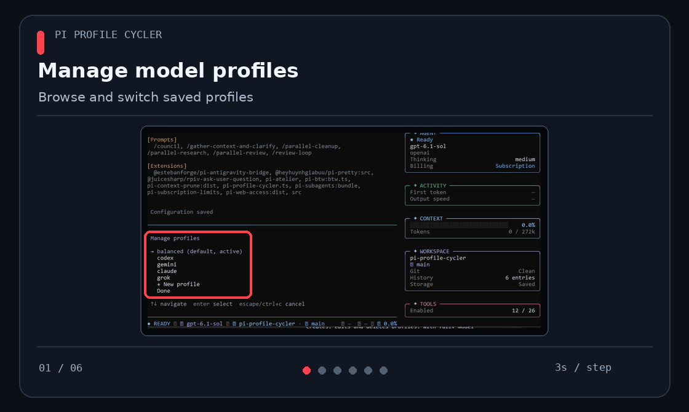

<div align="center">

# Pi Profile Cycler

**One keystroke to switch the model behind your orchestrator and every subagent.**

A [Pi](https://github.com/earendil-works/pi) extension for [`mavam/pi-agents`](https://github.com/mavam/pi-agents)

[](LICENSE)




</div>

---

Out of quota on one provider? Want Opus for planning and Haiku for everything else? Instead of editing agent files or restarting Pi, save your setups as **profiles** and flip between them mid-conversation.

```text
Alt+M   balanced  →  claude  →  codex  →  balanced …
```

## ✨ Features

| | |
|---|---|
| ⚡ **One key** | `Alt+M` cycles profiles; the parent model, its thinking and the routes for new subagents change together. |
| 🛠️ **Built-in editor** | `/hprofile manage` creates, edits and deletes profiles without touching JSON. |
| 🔎 **Fuzzy model search** | Type `opu` and only the Opus models are left. Only thinking levels the model supports are offered. |
| 🧭 **Per-role routing** | `implementer` on Sonnet, `reviewer` on Gemini, everything else on one `default`. |
| 🤖 **Knows your subagents** | Finds every agent in `~/.pi/agent/agents` and your trusted project's `.pi/agents`. |
| 🗣️ **You still decide** | Ask the orchestrator for a specific model and it wins over the profile. |
| 🌳 **Session-aware** | Each conversation branch remembers its own profile across resume, fork and `/tree`. |
| 🛡️ **Safe by design** | Models are validated before switching or saving; failures roll back; saves are atomic with a `.bak`. Your agent files are never modified. |

## 🚀 Quick start

Requires Pi 1.5.x with `mavam/pi-agents`.

**1. Install**

```sh
pi install git:github.com/nanonoir/pi-profile-cycler
```

**2. Create your first profile**: open Pi and run `/hprofile manage` → **+ New profile** → pick a default model → **Save**. It is activated right away.

**3. Switch**: add more profiles the same way and press `Alt+M`.

Until you create a profile nothing changes: subagents keep mavam's own routing.

<details>
<summary><b>Or start from the example profiles</b></summary>

Skip this if you already have a `profile-cycler.json`. Then adjust the models in `/hprofile manage`.

macOS / Linux:

```sh
curl -fsSL -o ~/.pi/agent/profile-cycler.json https://raw.githubusercontent.com/nanonoir/pi-profile-cycler/main/examples/profile-cycler.json
```

Windows (PowerShell):

```powershell
Invoke-WebRequest https://raw.githubusercontent.com/nanonoir/pi-profile-cycler/main/examples/profile-cycler.json -OutFile "$HOME\.pi\agent\profile-cycler.json"
```

</details>

## ⌨️ Commands

| Command | What it does |
|---|---|
| `Alt+M` · `/hprofile next` | Next profile |
| `/hprofile` | Pick a profile from a menu |
| `/hprofile <name>` | Activate a profile |
| `/hprofile manage` | Create, edit, delete and activate profiles |
| `/hprofile status` | Active profile, real parent model and where each subagent route comes from |
| `/hprofile reload` | Apply hand edits to the JSON; on error the previous config stays |

If Pi is busy, a switch is queued and applied as soon as the current run settles.

## 🛠️ Managing profiles

`/hprofile manage` opens a menu: arrows to move, **Enter** to choose, **Esc** to go back.

- **New profile**: pick a default model, then fine-tune the orchestrator or any subagent.
- **Edit**: every subagent shows what it uses today: its own route, `default`, or mavam's `native` setting.
- **Save**: validates the models you changed, keeps `profile-cycler.json.bak` and applies the profile.
- **Delete** and **Set as default** ask for confirmation and save right away.

If the file changes on disk while you edit, nothing is overwritten; just reopen the editor.

## ⚙️ How a subagent gets its model

```text
model you ask for  →  role in the profile  →  profile default  →  mavam's own setting
```

The orchestrator uses the profile's `main`, or its `default` when there is no `main`. If you ask for a model without a thinking level, mavam picks the level.

<details>
<summary><b>Prefer JSON?</b> <code>~/.pi/agent/profile-cycler.json</code></summary>

```json
{
  "version": 2,
  "defaultProfile": "balanced",
  "order": ["balanced", "fast"],
  "profiles": {
    "balanced": {
      "main": { "model": "openai/gpt-6.1-sol", "thinking": "medium" },
      "agents": {
        "implementer": { "model": "claude-code/claude-sonnet-5-5", "thinking": "medium" },
        "reviewer": { "model": "antigravity/gemini-3-8-flash", "thinking": "high" }
      }
    },
    "fast": {
      "default": { "model": "claude-code/claude-haiku-5-5", "thinking": "high" }
    }
  }
}
```

- `main` is the orchestrator; `agents` maps any mavam role to a model.
- `default` covers the orchestrator (when there is no `main`) and every subagent without its own route.
- Each profile needs `main` or `default`. Run `/hprofile reload` after editing.

</details>

## ⚠️ Good to know

- Only **new direct** subagents are routed; agents already running keep their model.
- **Nested** subagents (spawned by other subagents) use mavam's own routing.
- On Windows Pi reserves `Alt+P`, which is why the shortcut is `Alt+M`.

## 🧑‍💻 Development

```sh
npm ci && npm test && npm run typecheck
```

[Architecture](docs/architecture.md) · [Compatibility](docs/compatibility.md) · [Manual testing](docs/manual-testing.md) · [PRD](docs/pi-agents-profile-cycler.md)

---

<div align="center">
<sub><a href="LICENSE">MIT</a> © 2026 Nahuel Nicolas Noir (<a href="https://github.com/nanonoir">nanonoir</a>) · Not an official pi-agents plugin</sub>
</div>
